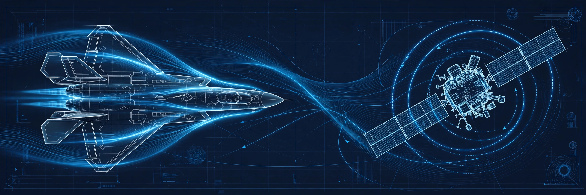

# Hi 👋, I'm Mustafa Soliman
### Second-year Aerospace Engineering Student — Cairo, Egypt

- 🎓 Studying Aeronautics & Space / Aerospace Engineering (2nd year)
- ✈️ Interested in Aerodynamics, Flight Mechanics, Propulsion, and Space Systems
- 💻 Working with Python and MATLAB for engineering simulation and problem-solving, and learning CAD / CFD fundamentals
- 🌱 Currently learning: Computational Fluid Dynamics (CFD), Orbital Mechanics, Aircraft Structures
- 🔭 Seeking an Aerospace Engineering internship (in Egypt or remote)
- 📫 How to reach me: through GitHub

---

## About Me

I'm Mustafa Soliman, a second-year Aerospace Engineering student at Cairo University, passionate about how aircraft fly and how spacecraft reach orbit. I'm building my engineering foundations step by step — from the physics of flight to the tools engineers use to design and simulate it — and I'm looking for an internship where I can learn from real aerospace work.

## Focus Areas

- ✈️ **Aerodynamics** — lift, drag, and airflow around wings and bodies
- 🛩️ **Flight Mechanics** — aircraft performance, stability, and control
- 🚀 **Propulsion** — how engines and rockets generate thrust
- 🛰️ **Space Systems** — orbital mechanics and satellite mission basics
- 🏗️ **Aircraft Structures** — how airframes carry loads safely

## Tools & Skills I'm Building

I'm still learning these tools and using them for coursework and small practice problems — not claiming expert-level skills:

- **Python** — engineering calculations, data analysis, and simple simulations
- **MATLAB** — numerical problem-solving and engineering simulation
- **Engineering Simulation** — applying maths and physics to model flight problems
- **CAD** — learning the fundamentals of computer-aided design
- **CFD basics** — learning the fundamentals of computational fluid dynamics

## 🚀 Featured Project
- **[Projectile Motion Lab](https://projectile-motion-chi.vercel.app/)** — Interactive simulator for projectile trajectories with wind and gravity (9.81 m/s²). [Try it live](https://projectile-motion-chi.vercel.app/) · [Code](https://github.com/mustafamuhamed077/projectile-motion)

## What I'm Looking For

I'm seeking an **Aerospace Engineering internship** (in Egypt or remote) where I can support a team, learn industry tools and workflows, and apply what I'm studying in aerodynamics, flight mechanics, and space systems. I'm eager to learn, happy to start with foundational tasks, and open to guidance and mentorship.

## GitHub Stats

---

*Thanks for visiting my profile!* 🚀
